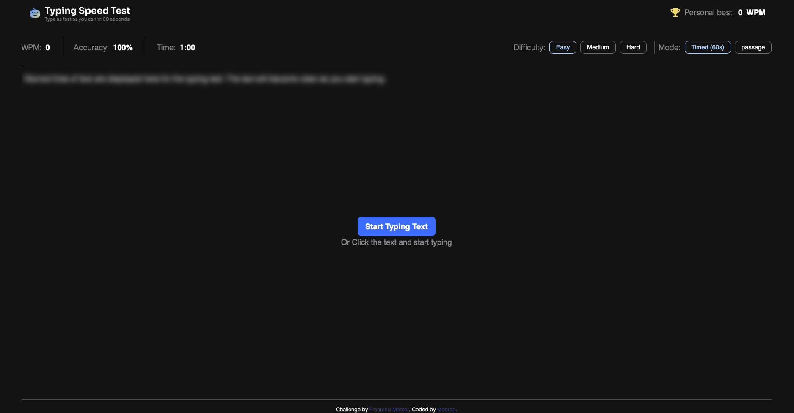

# Typing Speed Test

## Welcome! 👋

Thanks for checking out this page. You are now able to evaluate your typing skills. This time, you have the right tool to showcase your skills. Give it a go at (https://mehran-ag.github.io/typing-speed-test/)

**Prepare yourself for a fun challenge.**

## The challenge

Your challenge is to type as fast as you can. You are able to choose between "easy", "medium", and "difficult" texts.

You are able to:

#### Test Controls

- Start a test by clicking the start button
- Select a difficulty level (Easy, Medium, Hard) for passages of varying complexity
- Switch between "Timed (60s)" mode and "Passage" mode (timer counts up, no limit)
- Restart at any time to get a new random passage from the selected difficulty

#### Typing Experience

- See real-time WPM, accuracy, and time stats while typing
- See visual feedback showing correct characters (green), errors (red/underlined), and cursor position

#### Results & Progress

- View results showing WPM, accuracy, and characters (correct/incorrect) after completing a test

### Expected Behaviors

- **Starting the test**: The timer begins when you click the start button.
- **Timed mode**: 60-second countdown. Test ends when timer reaches 0 or passage is completed
- **Passage mode**: Timer counts up with no limit. Test ends when the full passage is typed
- **Error handling**: Incorrect characters are highlighted in red with an underline.
